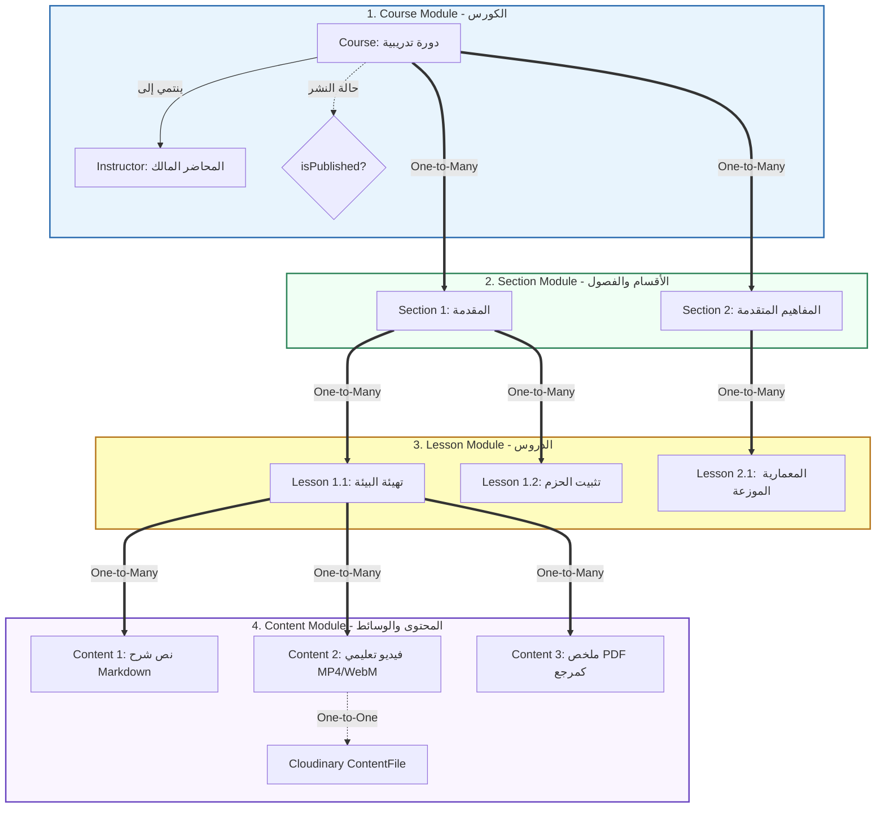
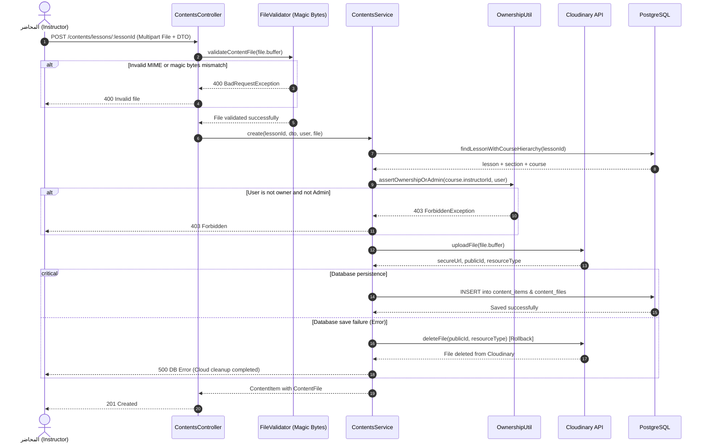

# LMS Course Feature Documentation

This document describes the complete architecture, data models, business logic, authorization rules, and workflows for the **Course Feature**, which encompasses:
1. **Course Module** (`CoursesModule`)
2. **Section Module** (`SectionsModule`)
3. **Lesson Module** (`LessonsModule`)
4. **Content Module** (`ContentsModule`) with Cloudinary file upload integration.

---

## 1. Entity Relationship Diagram (ERD)

```mermaid
erDiagram
    USERS ||--o{ COURSES : "creates / owns (1:N)"
    COURSES ||--o{ SECTIONS : "contains (1:N) [CASCADE]"
    SECTIONS ||--o{ LESSONS : "contains (1:N) [CASCADE]"
    LESSONS ||--o{ CONTENT_ITEMS : "contains (1:N) [CASCADE]"
    CONTENT_ITEMS ||--o| CONTENT_FILES : "attaches (1:1) [CASCADE]"

    USERS {
        uuid id PK
        string email
        string role "student | instructor | admin"
    }

    COURSES {
        uuid id PK
        uuid instructor_id FK
        string title
        text description
        string category
        text_array topics
        enum difficulty "beginner | intermediate | advanced"
        string language
        text_array prerequisites
        int estimated_duration
        boolean is_published
        timestamptz created_at
        timestamptz updated_at
        timestamptz deleted_at "Soft Delete"
    }

    SECTIONS {
        uuid id PK
        uuid course_id FK
        string title
        int order_index "Partial Unique (course_id, order_index)"
        timestamptz created_at
        timestamptz updated_at
        timestamptz deleted_at "Soft Delete"
    }

    LESSONS {
        uuid id PK
        uuid section_id FK
        string title
        int order_index "Partial Unique (section_id, order_index)"
        string topic
        enum difficulty "beginner | intermediate | advanced"
        text_array prerequisites
        timestamptz created_at
        timestamptz updated_at
        timestamptz deleted_at "Soft Delete"
    }

    CONTENT_ITEMS {
        uuid id PK
        uuid lesson_id FK
        string title
        enum content_type "text | video | image"
        string content_subtype
        text body_text "Check constraint"
        varchar video_url "Check constraint"
        varchar image_url "Check constraint"
        int duration_seconds ">= 0"
        string language
        int order_index ">= 0, Partial Unique (lesson_id, order_index)"
        text_array tags
        timestamptz created_at
        timestamptz updated_at
        timestamptz deleted_at "Soft Delete"
    }

    CONTENT_FILES {
        uuid id PK
        uuid content_item_id FK "Unique (1:1)"
        varchar secure_url
        varchar public_id
        varchar resource_type
        varchar original_name
        varchar mime_type
        bigint file_size
        timestamptz created_at
    }
```

---

## 2. Hierarchical Flow

---

## 3. Sequence Diagram: Content Creation with File Upload & Compensating Rollback

---

## 4. API Endpoints Matrix

| Method | Path | Auth & Role | Description |
| :--- | :--- | :--- | :--- |
| **POST** | `/courses` | `INSTRUCTOR`, `ADMIN` | Create a new course (draft by default) |
| **GET** | `/courses` | Public / Authenticated | Paginated course list (Students see published only) |
| **GET** | `/courses/:id` | Public / Authenticated | Course details (Owner/Admin sees full tree) |
| **PATCH** | `/courses/:id` | `OWNER`, `ADMIN` | Update course details |
| **DELETE** | `/courses/:id` | `OWNER`, `ADMIN` | Soft delete course |
| **POST** | `/courses/:courseId/sections` | `OWNER`, `ADMIN` | Create section in course |
| **GET** | `/courses/:courseId/sections` | Public / Authenticated | List sections for course |
| **GET** | `/sections/:id` | Public / Authenticated | Section details |
| **PATCH** | `/sections/:id` | `OWNER`, `ADMIN` | Update section title / orderIndex |
| **DELETE** | `/sections/:id` | `OWNER`, `ADMIN` | Soft delete section |
| **POST** | `/sections/:sectionId/lessons` | `OWNER`, `ADMIN` | Create lesson in section |
| **GET** | `/sections/:sectionId/lessons` | Public / Authenticated | List lessons in section |
| **GET** | `/lessons/:id` | Public / Authenticated | Lesson details with nested content items |
| **PATCH** | `/lessons/:id` | `OWNER`, `ADMIN` | Update lesson metadata / orderIndex |
| **DELETE** | `/lessons/:id` | `OWNER`, `ADMIN` | Soft delete lesson |
| **POST** | `/lessons/:lessonId/contents` | `OWNER`, `ADMIN` | Add content item (text/video/image + file upload) |
| **GET** | `/lessons/:lessonId/contents` | Public / Authenticated | List content items in lesson |
| **GET** | `/contents/:id` | Public / Authenticated | Content item details |
| **PATCH** | `/contents/:id` | `OWNER`, `ADMIN` | Update content item |
| **DELETE** | `/contents/:id` | `OWNER`, `ADMIN` | Soft delete content item |
